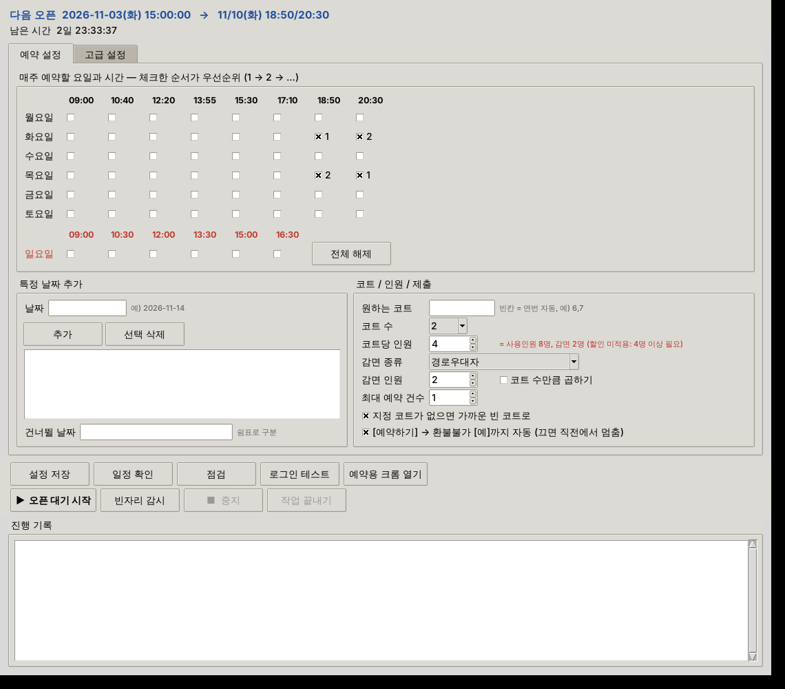

# 안양도시공사 체육시설 반자동 예약 도우미

예약할 날짜와 시간을 정해 두면, 그 날짜가 열리는 순간(**이용일 7일 전 15:00**)을 기다렸다가 시간과 코트를 우선순위대로 골라 예약을 제출합니다.
`auto_submit: true`면 [예약하기] → [예]까지 자동, `false`면 그 직전에서 멈추고 알림을 보냅니다.
**결제, 비밀번호 입력, 보안문자/본인인증은 사용자가 직접** 합니다.

- 의존성: Python 3.10+ 와 Playwright 하나 (나머지는 표준 라이브러리)
- 브라우저: PC에 설치된 **실제 Chrome** (키보드보안 EasykeyTec 연동 목적)

## 폴더 구조

```
auc_reserve/
├── gui.py             # 창(GUI) 프로그램
├── main.py            # 핵심 로직 + 명령행 실행 (--login/--check/--inspect/--open/--watch)
├── schedule.py        # 오픈 일시·목표 날짜 계산
├── site_selectors.py  # 사이트 셀렉터 (⚠ 추정값, 반드시 확인)
├── notifier.py        # 소리 + 텔레그램 알림
├── timesync.py        # NTP / 서버 시간 보정
├── config.json        # 예약 조건
├── .env.example       # 아이디 (복사해서 .env)
├── run_weekly.bat     # 작업 스케줄러가 실행할 파일 (exe가 있으면 exe 실행)
├── build_exe.bat      # PC에서 exe 직접 빌드
├── start_gui.bat      # Python으로 창 버전 실행
├── register_task.bat  # 작업 스케줄러 등록
└── tests/             # 단위 테스트
```

## 창(GUI) 프로그램으로 쓰기

`AUC_Reserve.exe`(또는 `start_gui.bat` / `python gui.py`)를 실행하면 창이 열립니다.



- **위쪽:** 다음 오픈 일시와 목표 날짜, 남은 시간
- **예약 설정 탭:** 요일 × 시간 체크표(**체크한 순서가 우선순위**, 칸 옆에 1·2·3 표시), 특정 날짜(날짜 입력 → 그 요일 시간표 체크 → 추가), 건너뛸 날짜, 원하는 코트(빈칸 = 연번 자동), 코트 수, 사용인원, [예]까지 자동 여부
- **고급 설정 탭:** 오픈 시각, 감시 범위/간격, 텔레그램, 알림 소리, **로그인 방식(통합 로그인 / 공사회원)**
- **버튼:** 설정 저장 / 일정 확인 / 점검 / 로그인 테스트 / **예약용 크롬 열기** / ▶ 오픈 대기 시작 / 빈자리 감시 / ■ 중지 / 작업 끝내기 (크롬은 유지)
- **진행 기록:** 실시간 로그. 자리 확보·로그인 필요 같은 중요한 알림은 맨 앞에 팝업으로 뜹니다.

설정은 같은 폴더의 `config.json`에 저장됩니다.

### exe 받기
1. GitHub 저장소 → **Actions** → "AUC Reserve - Windows exe" → 최신 실행 → 아래 **Artifacts**에서 `AUC_Reserve-win64` 다운로드
   (또는 PC에서 `build_exe.bat` 실행 → `dist\AUC_Reserve\`)
2. 압축을 풀어 `AUC_Reserve.exe`와 `config.json`을 **같은 폴더**에 둡니다.

- PC에 **Chrome이 설치**되어 있어야 합니다.
- **브라우저:** 프로그램이 일반 크롬(chrome.exe)을 **예약 전용 프로필**로 띄우고 거기에 연결합니다 (`browser.mode: "cdp"`).
  자동화 표시가 없는 평소 크롬이라 키보드보안이 정상 동작하고, **작업이 끝나도 크롬은 닫히지 않습니다.**
  한 번 로그인해 두면 다음 실행 때 그 크롬에 다시 연결하므로 로그인이 유지됩니다.
  (평소 쓰는 기본 프로필은 Chrome 보안 정책상 원격 연결이 막혀 있어 사용할 수 없습니다.)
- **로그인된 크롬 쓰기:** [예약용 크롬 열기]로 크롬을 띄워 한 번 로그인하고 **창을 닫지 말고** 두세요.
  이후 작업은 모두 그 크롬에 붙어서 진행합니다 (보안문자·로그인 차단을 피하는 데 유리).
  다른 프로그램(예: 블로그 에이전트)이 이미 디버깅 포트로 띄운 로그인된 크롬이 있으면,
  고급 설정의 **프로필 폴더·포트**를 그것과 같게 넣으면 그 크롬을 그대로 씁니다.
- 고급 설정: 예약용 크롬 프로필 폴더(상대 경로는 프로그램 폴더 기준), 연결 포트(기본 9222), chrome.exe 경로(비우면 자동).
  평소 크롬의 기본 프로필(`%LOCALAPPDATA%\Google\Chrome\User Data`)은 Chrome 136부터 연결이 막혀 있어 쓸 수 없습니다.
- 처음 실행할 때 SmartScreen 경고가 뜨면 "추가 정보 → 실행" (서명 안 된 exe).
- 명령행 옵션도 그대로 됩니다: `AUC_Reserve.exe --open --dry-run` (창 모드 exe라 결과는 `logs` 폴더에 기록)

### 매일 자동 실행
`register_task.bat`으로 등록하면 매일 14:20에 `run_weekly.bat` → `AUC_Reserve.exe --auto`가 실행됩니다.
창이 뜨면서 바로 오픈 대기를 시작하고, 그날 열리는 목표 날짜가 없으면 10초 뒤 창이 저절로 닫힙니다.

## 설치 (Windows, Python으로 실행)

```bat
pip install -r requirements.txt
copy .env.example .env
```

`playwright install`은 하지 않아도 됩니다. 설치된 Chrome을 사용합니다.
`.env`에 아이디만 넣으세요. 비밀번호는 넣지 않습니다.

## 사이트 구조 (2026-10-31 확인, 호계체육관 배드민턴장 `facilityCategoryNo=1`)

- **오픈 규칙(공지):** 이용일 **7일 전 15:00 ~ 1일 전 23:59**, 당일 예약 불가
- **시간표:** 평일 09:00 / 10:40 / 12:20 / 13:55 / 15:30 / 17:10 / 18:50 / 20:30 (각 90분), 일요일 09:00~16:30
- **코트 구분 없음:** `facilities`는 비워 두세요 (`[]`)
- **로그인:** `/sign/in/base/user`. **통합 로그인(안양시 SSO, 기본)**은 [통합 로그인 바로가기]를 자동으로 눌러 주고 사용자가 안양시 화면에서 로그인합니다. 공사회원은 아이디(`#id`)를 자동 입력하고 비밀번호(EasykeyTec 보호)는 직접 입력합니다. 로그인 완료는 화면을 건드리지 않고 백그라운드 조회로 확인합니다.
- **주의:** 일정 시간 동안 이용이 없으면 자동 로그아웃됩니다. 다른 IP에서 같은 계정으로 로그인하면 기존 접속이 끊깁니다.

## 예약 흐름과 자동화 범위

| 단계 | 화면 | 누가 |
|---|---|---|
| 1 | 달력에서 `가` 시간 클릭 → "…등록하시겠습니까?" 확인창 [예] | 스크립트 |
| 2 | 코트 선택 (`reservationStep2`, 1~12번, 최대 2면) → [다음] | 스크립트 (`courts` 우선순위) |
| 3 | 사용인원(코트 수 × 코트당 인원) + 감면 인원 입력 (`reservationStep2_2`) | 스크립트 |
| 4 | **[예약하기] → 확인창 [예]** | `auto_submit: true`면 스크립트, 아니면 사용자 |
| 5 | 결제 화면 (`reservationStep3`): **여기서 예약번호가 생기며 자리가 잡힘** → 스크립트는 알림만 보내고 끝 | - |
| 6 | 약관 동의 → [결제하기] → 카드 결제 | **사용자** |

**1~3단계에서는 서버에 아무것도 잡히지 않습니다.** 4단계 [예]를 누르는 순간 예약번호가 생기고 자리가 잡힙니다. 코트 선택과 인원 입력은 브라우저 안에서만 처리됩니다.
다른 사람이 같은 시간과 코트로 먼저 [예]를 누르면 그 사람이 가져갑니다. 알림이 오면 바로 [예약하기] → [예]를 누르세요.

결제 화면(5단계)과, 이미 예약된 코트가 코트 선택 화면에 어떻게 표시되는지는 아직 확인하지 못했습니다.
처음 실제로 예약할 때 `--inspect`로 저장해 두면 더 정확히 맞출 수 있습니다.

## 감면 할인 규칙 (사이트 계산 방식)

감면 할인은 **감면 인원이 사용인원의 절반 이상**일 때만 적용됩니다 (50%, 군·경·소만이면 10%).
예) 1면 4명 + 감면 2명 → 할인 / 2면 8명 + 감면 2명 → 미적용 (4명 필요 → "코트 수만큼 곱하기" 체크).
GUI의 코트당 인원 옆에 실제 입력될 인원과 할인 적용 여부가 표시됩니다.
감면은 실제 대상자일 때만 적용하세요 (현장에서 확인할 수 있습니다).

## 코트 선택 규칙

예약완료·강습·점검 코트는 색으로 표시되고 선택할 수 없습니다 (체크박스 `disabled`, `ver-red` 등). 이 코트는 건너뜁니다.

| 설정 | 동작 | 예 (`court_count: 2`) |
|---|---|---|
| `"courts": []` | 빈 코트 중 **연속 번호(연번)** 가장 앞 묶음 | 5번 예약됨 → **1·2번** / 1·3·5번 예약됨 → **6·7번** |
| `"courts": [6, 7]` | 지정 코트가 비어 있으면 그대로 | **6·7번** |
| 〃 (6번 예약됨) | 남은 7번 유지 + 7번에 붙은 빈 코트 | **7·8번** |
| 〃 (6·7번 예약됨) | 지정 위치에 가장 가까운 연번 묶음 | **4·5번** (4·5도 없으면 8·9번) |

연번 묶음이 아예 없으면 서로 가장 가까운 코트를 고릅니다.

## config.json

**예약할 날짜 정하기** (둘 다 써도 됨)
- `target_days`: 매주 반복할 요일. 예) 매주 화요일 18:50 → `{ "weekday": "TUE", "times": ["18:50", "20:30"] }`
- `extra_dates`: 특정 날짜. 예) `{ "date": "2026-11-14", "times": ["10:40"] }`

오픈 시각은 날짜마다 자동으로 계산됩니다. **11/10을 정하면 11/3 15:00에 열립니다.**

| 키 | 설명 |
|---|---|
| `open_mode` | `rolling` = 이용일 N일 전 오픈 (이 사이트) / `weekly` = 매주 같은 요일에 한꺼번에 오픈 |
| `open_days_before`, `open_time` | 며칠 전 몇 시에 열리는지 (기본 7일 전 15:00) |
| `open_window_min` | 예상 오픈 시각 앞뒤 몇 분을 집중 감시할지 (기본 3분) |
| `poll_interval_sec` | 집중 감시 간격 (기본 1초, 최소 0.3초) |
| `fast_window_sec`, `fast_poll_interval_sec` | 예상 시각 ±20초 안에서는 0.5초 간격으로 더 촘촘히 |
| `block_images` | 이미지·글꼴을 받지 않아 화면 이동을 빠르게 (기본 `true`) |
| `turbo` | 화면마다 스크립트 한 번으로 처리 (기본 `true`) |
| `burst_window_sec`, `burst_interval_sec`, `open_offset_ms` | 오픈 ±3초는 0.3초 간격, 오픈 순간 +30ms에 1회 확인 |
| `open_weekday` | `weekly` 모드에서만 사용 |
| `target_days` | 반복 요일. 목록 순서가 우선순위. `times`도 앞쪽이 우선 (시작 시각으로 적기: `"18:50"`) |
| `extra_dates` | 특정 날짜: `"2026-11-14"` 또는 `{"date": "...", "times": [...]}` |
| `skip_dates` | 건너뛸 날짜 |
| `default_times` | `extra_dates`에 시간을 안 적었을 때 쓰는 값 |
| `max_per_week` | 한 번 실행에서 최대 예약 건수 (사이트 제한: 1인 총 2회) |
| `courts` | 원하는 코트 번호. `[]`이면 자동 (아래 규칙) |
| `court_count` | 한 번에 잡을 코트 수 (1 또는 2) |
| `court_fallback_any` | 지정 코트가 예약돼 있으면 가까운 빈 코트로 대신 채울지 (`true`/`false`) |
| `applicant.people_per_court` | 코트당 인원 (기본 4). 사용인원 = 고른 코트 수 × 이 값 (코트당 2~6명) |
| `reduction` | 감면: `type`(`reduction1` 국가유공자, `2` 장애인, `3` 경로우대자, `4` 안양시 다자녀, `5` 우수자원봉사자, `6` 장기·신체조직 기증자, `7` 군·경·소), `count` 인원, `per_court` 코트 수만큼 곱하기 |
| `auto_submit` | `true`: [예약하기] → 확인창 [예]까지 자동 (결제는 직접). `false`: [예약하기] 직전에서 멈추고 알림 |
| `auto_agree_terms` | 기본 `false`. `true`면 결제 화면의 필수 약관 3개만 자동 체크 ([결제하기]는 항상 직접) |
| `retry_on_conflict` | 다른 사람이 먼저 예약해 실패하면 남은 시간/코트로 다시 시도할 횟수 (기본 1) |
| `notify` | 텔레그램 봇 토큰, chat_id, 소리 사용 여부 |
| `watch_on_fail` | 전부 마감일 때 감시 모드 전환: `ask` / `auto` / `off` |
| `final_wait_min` | [예약하기]를 기다리는 시간(분) |
| `keepalive_min` | 세션 유지 점검 간격(분, 최소 5) |
| `max_wait_after_open_min` | 오픈이 안 될 때 기다리는 최대 시간(분) |

## 실행 모드

```bat
python main.py --open --dry-run   :: 브라우저 없이 목표 날짜와 일정만 확인
python main.py --login            :: 로그인 테스트
python main.py --check            :: 셀렉터 / 로그인 / 시간 오차 점검
python main.py --open             :: 오픈 대기 → 즉시 예약
python main.py --open --open-at "2026-11-01 16:00"   :: 예상 오픈 시각 직접 지정
python main.py --watch            :: 빈자리 감시 (30초 + 랜덤 0~15초 간격)
```

## --open 동작 순서 (예상 오픈 15:00, 집중 감시 ±3분)

| 시각 | 동작 |
|---|---|
| 14:27, 14:47 | 로그인 점검 (끊겼으면 알림 → 직접 로그인) |
| 14:52 | NTP + **사이트 서버 시간 정밀 측정** (응답 헤더의 초가 바뀌는 순간을 잡아 수십 ms 정밀도) |
| 14:56 | 목표 날짜 달력을 열어 둠 |
| 14:57 ~ 15:03 | **달력 HTML만 1초 간격으로 받아서 확인** (화면은 새로고침하지 않음). 14:59:40 ~ 15:00:20은 0.5초 간격 |
| **열림 감지** | 열어 둔 달력에서 사이트의 시간 선택 함수를 바로 실행 → 코트 선택 → [다음] → 인원 입력 |
| 제출 | `auto_submit: true`: **[예약하기] → [예]** 자동 → "결제를 진행해주세요" 알림 / `false`: 직전에서 멈추고 알림 |
| 충돌 | "이미 예약된 코트" 등으로 실패하면 남은 시간/코트로 1번 재시도 |
| 15:03 이후 | 안 열렸으면 5초 간격으로 계속 확인 + 알림. 15:30에 중단 |

모의 테스트 결과 (서버 응답 0.12~0.15초 가정, 정각 오픈):

| 방식 | 오픈 → [예]까지 |
|---|---|
| 일반 (요소마다 찾기·클릭) | 약 2.0초 |
| **터보** (기본값, 화면마다 스크립트 한 번) | **약 0.9초** |

- 오픈 ±3초 동안은 0.3초 간격으로 확인하고, **오픈 순간 + 30ms에 반드시 한 번** 확인하도록 맞춥니다 (`burst_window_sec`, `burst_interval_sec`, `open_offset_ms`).
- 다른 사람이 먼저 예약해 실패하면 0.7초 안에 판정하고, 달력 HTML만 다시 받아 남은 시간/코트로 바로 재시도합니다.
- 터보가 중간에 실패하면 그 화면에서부터 일반 방식으로 이어서 진행합니다.

### 예상 오픈 시각을 직접 지정하기

정확한 시각을 모를 때는 예상 시각을 넣고 앞뒤 3분을 감시합니다.

```bat
python main.py --open --open-at "2026-11-01 15:00"
```

그날 열리는 날짜(7일 뒤, 위 예시라면 11/8)가 `target_days`나 `extra_dates`에 들어 있어야 합니다.
매번 같은 시각이면 `config.json`의 `open_time`만 바꾸면 됩니다.

## 매주 자동 실행

1. `register_task.bat`를 실행하면 **매일 14:20**에 `run_weekly.bat`가 실행되도록 등록됩니다. 그날 열리는 목표 날짜가 없으면 바로 종료합니다.
2. Windows 설정 → 전원에서 **절전 모드 '안 함'** 으로 바꿉니다. 화면 꺼짐은 괜찮습니다.
3. 작업 스케줄러는 '사용자가 로그온할 때만 실행'(기본값)으로 둡니다. 브라우저 창이 보여야 직접 클릭할 수 있습니다.

## 체크리스트

- [ ] `python main.py --open --dry-run`으로 목표 날짜 확인 (`skip_dates` 수정)
- [ ] `python main.py --check`로 셀렉터 개수가 0이 아닌지 확인
- [ ] 텔레그램 알림 수신 확인
- [ ] 오픈일 15:00에 PC 앞에 있기 ([예약하기] → [예]는 직접)

## 알아둘 점

- **세션 쿠키:** Chrome을 닫으면 로그인이 풀리는 사이트가 많습니다. 그래서 `--open`은 시작할 때 로그인을 확인하고 브라우저를 계속 띄워 둡니다. `--login`은 테스트용입니다.
- **확인창(confirm):** 자동 단계에서 "예약하시겠습니까?" 같은 확인창이 뜨면 **취소**하고 사용자에게 넘깁니다. 사용자가 최종 버튼을 누른 뒤 뜨는 확인창은 자동으로 '확인'됩니다. 그 클릭이 사용자의 의사이기 때문입니다.
- **새 창 / 인증:** 새 창이 열리거나 보안문자, 본인인증, 대기열이 감지되면 멈추고 알림을 보냅니다. 우회하지 않습니다.
- **오류:** 오류가 나도 브라우저를 닫지 않습니다. 화면에서 직접 이어서 진행하세요. 로그와 스크린샷은 `logs/`에 남습니다.
- 사이트 이용약관을 확인하고, 1인 개인 용도로만 사용하세요.

## 테스트

```bat
python -m unittest discover -s tests
```
